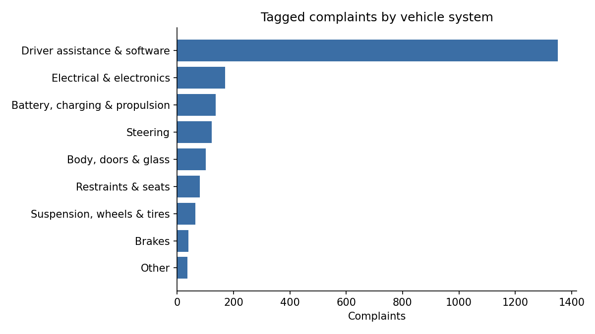

# Tesla service complaint summary

Generated 2026-11-13 from 2103 NHTSA complaints (Model 3, Model Y, model years 2021-2024), tagged by `deepseek-flash` (1285), `claude-opus-5-5` (818).

## Headline

- **Driver assistance & software** is the largest category: 1351 complaints (64.2% of the total), 84.4% of them safety-critical.
- The LLM's category agrees with NHTSA's own component label on **81.0%** of complaints.

## Volume by vehicle system

| category                       |   complaints |   share_pct |   safety_critical_pct |   service_visit_pct |
|:-------------------------------|-------------:|------------:|----------------------:|--------------------:|
| Driver assistance & software   |         1351 |        64.2 |                  84.4 |                 9.7 |
| Electrical & electronics       |          171 |         8.1 |                  25.1 |                31.6 |
| Battery, charging & propulsion |          137 |         6.5 |                  80.3 |                38   |
| Steering                       |          122 |         5.8 |                  74.6 |                37.7 |
| Body, doors & glass            |          101 |         4.8 |                  46.5 |                23.8 |
| Restraints & seats             |           80 |         3.8 |                  85   |                26.3 |
| Suspension, wheels & tires     |           65 |         3.1 |                  35.4 |                66.2 |
| Brakes                         |           40 |         1.9 |                  82.5 |                20   |
| Other                          |           36 |         1.7 |                  30.6 |                33.3 |

## Failure type mix

| failure_type            |   complaints |   share_pct |
|:------------------------|-------------:|------------:|
| Software or calibration |         1454 |        69.1 |
| Hardware failure        |          442 |        21   |
| Unclear                 |          124 |         5.9 |
| Build quality or fit    |           55 |         2.6 |
| Wear or premature wear  |           28 |         1.3 |

## Out-of-pocket repair cost stated by owners

Only complaints where the owner states an amount; categories with fewer than 3 are left out.

| category                     |   complaints_with_cost |   avg_usd |   max_usd |
|:-----------------------------|-----------------------:|----------:|----------:|
| Driver assistance & software |                     10 |      1895 |      3400 |
| Electrical & electronics     |                      4 |      1397 |      3000 |
| Suspension, wheels & tires   |                      6 |      1157 |      2035 |

## Complaints filed per month

| month   |   complaints |
|:--------|-------------:|
| 2020-12 |            1 |
| 2021-02 |            4 |
| 2021-03 |            2 |
| 2021-04 |            2 |
| 2021-05 |            2 |
| 2021-06 |            3 |
| 2021-07 |            3 |
| 2021-08 |            5 |
| 2021-09 |            4 |
| 2021-10 |            4 |
| 2021-11 |           28 |
| 2021-12 |           24 |
| 2022-01 |           32 |
| 2022-02 |          292 |
| 2022-03 |           81 |
| 2022-04 |           18 |
| 2022-05 |           28 |
| 2022-06 |           98 |
| 2022-07 |           66 |
| 2022-08 |           46 |
| 2022-09 |           40 |
| 2022-10 |           30 |
| 2022-11 |           27 |
| 2022-12 |           35 |
| 2023-01 |           33 |
| 2023-02 |           23 |
| 2023-03 |           31 |
| 2023-04 |           26 |
| 2023-05 |           39 |
| 2023-06 |           26 |
| 2023-07 |           52 |
| 2023-08 |           72 |
| 2023-09 |           49 |
| 2023-10 |           35 |
| 2023-11 |           23 |
| 2023-12 |           35 |
| 2024-01 |           40 |
| 2024-02 |           29 |
| 2024-03 |           19 |
| 2024-04 |           39 |
| 2024-05 |           18 |
| 2024-06 |           28 |
| 2024-07 |           25 |
| 2024-08 |           44 |
| 2024-09 |           23 |
| 2024-10 |           31 |
| 2024-11 |           24 |
| 2024-12 |           27 |
| 2025-01 |           33 |
| 2025-02 |           16 |
| 2025-03 |           20 |
| 2025-04 |           10 |
| 2025-05 |           14 |
| 2025-06 |           16 |
| 2025-07 |           20 |
| 2025-08 |           20 |
| 2025-09 |           23 |
| 2025-10 |           30 |
| 2025-11 |           23 |
| 2025-12 |           16 |
| 2026-01 |           11 |
| 2026-02 |           19 |
| 2026-03 |           11 |
| 2026-04 |           12 |
| 2026-05 |           16 |
| 2026-06 |           22 |
| 2026-07 |           21 |
| 2026-08 |           32 |
| 2026-09 |           23 |
| 2026-10 |           24 |
| 2026-11 |            5 |

## Tagging quality

Agreement means the LLM's single category is among the categories NHTSA assigned. The LLM only sees the complaint text, never NHTSA's label.

| category                       |   complaints |   agreement |
|:-------------------------------|-------------:|------------:|
| Driver assistance & software   |         1351 |        90.2 |
| Electrical & electronics       |          171 |        46.2 |
| Battery, charging & propulsion |          137 |        37.2 |
| Steering                       |          122 |        91.8 |
| Body, doors & glass            |          101 |        61.4 |
| Restraints & seats             |           80 |        93.8 |
| Suspension, wheels & tires     |           65 |        98.5 |
| Brakes                         |           40 |        85   |
| Other                          |           36 |        19.4 |

400 disagreements are listed in `disagreements.csv` for manual review.
